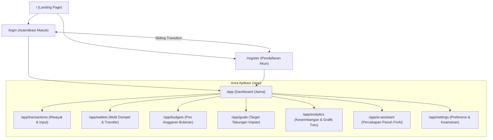
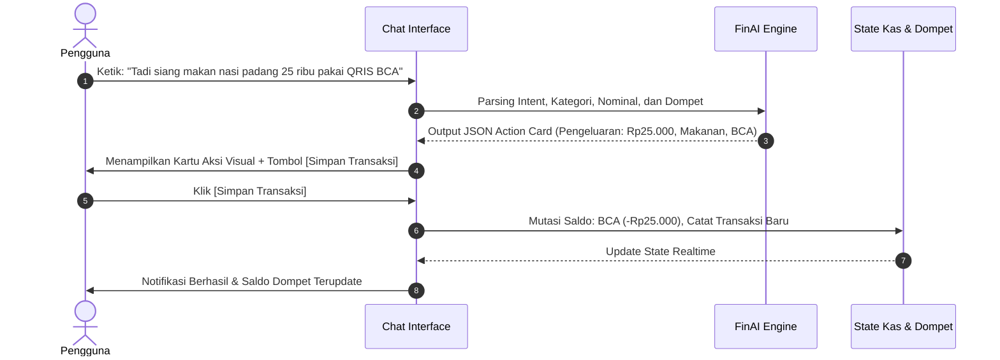

# 📘 DOKUMENTASI LENGKAP SISTEM FINAI (SPATIAL FINANCE)

> **FinAI** adalah *Personal Finance Assistant* modern berbasis kecerdasan buatan (AI) yang dirancang untuk membantu pengguna mengelola, merencanakan, dan memahami kondisi finansial mereka melalui antarmuka visual spasial yang tenang, elegan, dan intuitif (*Soft Premium Fintech*).

---

## 1. Ringkasan Eksekutif & Filosofi Desain

FinAI dibangun untuk memecahkan kebiasaan lama pencatatan keuangan manual yang kaku, rumit, dan membosankan. Melalui paradigma **Natural Language $\rightarrow$ Financial Action**, pengguna cukup bercerita atau mengetik transaksi sehari-hari seperti berkirim pesan dengan teman, dan sistem akan mengonversinya menjadi tindakan finansial nyata.

### Karakter Estetika (*Soft Premium Fintech*):
- **Clean & Modern**: Antarmuka minimalis tanpa elemen visual yang tidak relevan.
- **Calm & Friendly**: Warna-warna pastel lembut yang mengurangi kecemasan dalam mengelola uang.
- **Intelligent & Trustworthy**: Konfirmasi eksplisit sebelum saldo diubah, privasi data pengguna adalah prioritas tertinggi.
- **Strict Visual Rules**:
  - ❌ **Tanpa Emoji** (Semua ikon menggunakan SVG vektor resmi dari `lucide-react`).
  - ❌ **Tanpa 3D / WebGL** (Fokus pada kecepatan render, micro-animation Framer Motion, dan tipografi presisi).
  - ❌ **Tanpa Warna Neon / Dark Mode Berlebihan** (Konsistensi palet terang `#F6F7FB` dengan aksen lavender `#7C7CE6`).

---

## 2. Palet Warna & Desain Sistem

| Elemen / Token | Kode Warna | Penggunaan |
| :--- | :--- | :--- |
| **Canvas Background** | `#F6F7FB` | Latar belakang utama seluruh halaman |
| **Surface Card** | `#FFFFFF` | Kontainer kartu, modal popover, dan panel |
| **Primary Brand** | `#7C7CE6` | Tombol primer, aksen fokus, link aktif, hero emphasis |
| **Soft Lavender** | `#E4E2FB` | Badge status, background ilustrasi, highlight halus |
| **Ice Blue** | `#D6E4FA` | Aksen dompet digital, grafik pemasukan |
| **Mint Green** | `#D0EFE5` / `#1B7354` | Arus kas positif, indikator kesehatan keuangan prima |
| **Soft Coral** | `#FCE2E0` / `#B83A38` | Alert kesalahan, tag pengeluaran, konfirmasi bahaya |
| **Primary Text** | `#242636` | Judul, headline, angka saldo utama |
| **Secondary Text** | `#757A95` | Subtitle, label tanggal, deskripsi bantuan |

---

## 3. Peta Rute & Struktur Navigasi Aplikasi



---

## 4. Alur Kerja Utama Sistem (*Core User Flows*)

### 🔄 Alur 1: Onboarding & Autentikasi Pengguna
1. **Landing Page (`/`)**:
   - Pengguna disambut oleh pesan utama *"Kelola keuanganmu. Lebih mudah dengan FinAI"*.
   - Melihat visualisasi dompet aktif, ritme belanja 7 hari, target progres laptop, dan insight AI.
   - Menekan tombol **"Mulai Gratis"** diarahkan ke `/register`, atau **"Masuk"** ke `/login`.
2. **Single-Interface Auth Transition**:
   - Halaman Login dan Register tidak melakukan *hard page reload*.
   - Transisi pergeseran panel fisik menggunakan Framer Motion:
     - **Login**: Ilustrasi lanskap organik di **KIRI**, form di **KANAN**.
     - **Register**: Form di **KIRI**, ilustrasi lanskap di **KANAN**.
   - Validasi data input *real-time* inline dengan ikon `AlertCircle` tanpa alert bawaan browser.
3. **Pemberian Hak Akses**:
   - Setelah login/register berhasil, sistem langsung mengarahkan pengguna ke ruang kerja utama (`/app`).

---

### 💬 Alur 2: Pencatatan Transaksi Berbasis AI (*Natural Language $\rightarrow$ Action Card*)
Alur revolusioner yang membedakan FinAI dari aplikasi pencatatan konvensional:



---

### 💳 Alur 3: Manajemen Multi-Dompet & Transfer Saldo
1. **Halaman Dompet (`/app/wallets`)**:
   - Menampilkan total kekayaan bersih (*Net Worth*) dan daftar seluruh kantong keuangan (BCA, Mandiri, Cash/Tunai, GoPay, OVO).
2. **Pembuatan Dompet Baru**:
   - Pengguna memilih nama dompet, tipe (Bank, E-Wallet, Tunai), dan saldo awal.
3. **Penyelarasan Saldo & Pemindahan Dana**:
   - Pengguna menekan tombol *"Pindah Saldo / Transfer"*.
   - Memilih dompet sumber $\rightarrow$ dompet tujuan $\rightarrow$ nominal transfer.
   - Sistem secara atomik mengurangi saldo sumber dan menambah saldo tujuan secara instan tanpa selisih.

---

### 🎯 Alur 4: Perencanaan Target Impian & Setoran Tabungan
1. **Halaman Target (`/app/goals`)**:
   - Menampilkan target finansial jangka pendek dan jangka panjang (e.g. *Laptop Baru*, *Dana Darurat*, *Liburan ke Jepang*).
2. **Kalkulator Cerdas**:
   - Pengguna memasukkan nominal target dan tenggat waktu (bulan/tahun).
   - Sistem otomatis menghitung rekomendasi setoran bulanan yang realistis (contoh: *Rp2.125.000 / bulan selama 4 bulan tersisa*).
3. **Eksekusi Tambah Tabungan (*Contribution Modal*)**:
   - Pengguna memilih tombol *"Tambah Tabungan"*.
   - Memilih dompet sumber pendanaan dan nominal setoran.
   - Saldo dompet berkurang dan progres persentase target impian bertambah secara *real-time*.

---

### 📊 Alur 5: Pengawasan Anggaran & Evaluasi Analitis
1. **Pos Anggaran Bulanan (`/app/budgets`)**:
   - Pengguna menentukan batas maksimal pengeluaran per kategori (e.g. *Makanan & Minuman: Rp3.000.000/bulan*).
   - Indikator bar visual menampilkan rasio pemakaian:
     - **Aman (< 70%)**: Mint Green.
     - **Waspada (70% - 90%)**: Soft Orange.
     - **Kritis / Overbudget (> 90%)**: Soft Coral.
2. **Keseimbangan Arus Kas (`/app/analytics`)**:
   - Grafik garis interaktif 6 bulan membandingkan total pemasukan vs total pengeluaran.
   - Fitur hover tooltip untuk melihat detail mutasi kas per bulan.

---

## 5. Rincian Fitur & Modul Sistem

### 1. Modul Landing Page (`/`)
- **Fixed Floating Navbar**: Menempel di bagian atas layar dengan indikator garis progres scroll, transisi elevasi saat digulir, dan menu drawer responsif untuk mobile.
- **Hero Section**: Headline utama, tombol CTA *Mulai Gratis* & *Lihat Cara Kerja*, serta komposisi visual spasial interaktif (kartu dompet mengambang, mini spending bar 7 hari, target laptop, dan kartu insight AI).
- **Value Strip**: 4 pilar ringkas (*Catat, Atur, Rencanakan, Pahami*).
- **Fitur Lengkap (Grid 3 × 2)**: 6 kartu fitur dengan efek hover angkat mikro (`translateY(-3px)`).
- **AI Action Preview**: Simulasi interaktif pengubahan bahasa alami ke kartu transaksi kas.
- **How It Works**: Panduan 3 langkah praktis onboarding (`01`, `02`, `03`).
- **Target & Analisis Preview**: Showcase kartu target dan komponen grafik garis interaktif aplikasi.
- **Keamanan & Trust**: 3 kartu jaminan privasi data, kontrol pengguna, dan konfirmasi AI.
- **CTA Final & Footer**: Akses langsung pendaftaran dan informasi hak cipta.

---

### 2. Modul Autentikasi (`/login` & `/register`)
- **Sliding Panel Orchestration**: Perpindahan Login $\leftrightarrow$ Register secara fisik di dalam satu kontainer tanpa reload halaman.
- **Visual Lanskap Organik**: Lanskap pegunungan berkabut, danau lavender, siluet rusa bertanduk, dan pembatas gelombang S-curve SVG.
- **Form Login**: Email, Password (dengan tombol intip), Lupa password, Checkbox kustom "Ingat saya", tombol masuk ber-spinner, dan tombol SSO Google & Apple.
- **Form Register**: Grid 2 kolom (Nama Lengkap, Email, Password, Konfirmasi Password), helper minimal 8 karakter, persetujuan Syarat & Privasi, serta tombol submit.
- **Validasi Kustom**: Deteksi kesalahan format email dan kecocokan kata sandi secara instan dengan alert warna soft coral.

---

### 3. Modul Dashboard Utama (`/app`)
- **Global Sidebar**: Pengelompokan menu fungsional dengan accordion/dropdown yang dapat diciutkan, indikator halaman aktif, dan profil pengguna dengan menu keluar (*Logout*).
- **Header Finansial**: Salam personal, tanggal real-time bahasa Indonesia, dan status sinkronisasi akun.
- **Kartu Total Saldo Spasial**: Total saldo agregat, kartu master wallet, dan dropdown pilihan filter dompet yang tidak terpotong radius.
- **Aksi Cepat 8 Tombol**: Tombol tindakan instan (*Catat Pemasukan, Catat Pengeluaran, Transfer Antar Dompet, Tambah Dompet, Buat Target Baru, Lihat Laporan, Atur Anggaran, Tanya FinAI*).
- **Ringkasan Arus Kas**: Widget perbandingan pemasukan bulanan, pengeluaran bulanan, dan tabungan tersimpan.
- **Grafik Keseimbangan**: Visualisasi grafik garis interaktif arus kas 6 bulan.
- **Riwayat Mutasi Terkini**: Daftar transaksi mutasi terakhir dengan badge kategori dan nominal berwarna dinamis.

---

### 4. Modul Transaksi (`/app/transactions`)
- Filter pencarian cepat berdasarkan nama transaksi, kategori pengeluaran/pemasukan, dan rentang tanggal.
- Tombol tambah transaksi manual dengan modal form lengkap.
- Aksi edit dan hapus transaksi dengan pembaruan otomatis ke saldo dompet terkait.
- Fitur ekspor laporan transaksi ke format CSV / data terstruktur.

---

### 5. Modul Dompet (`/app/wallets`)
- Tampilan kartu dompet virtual dengan kode identitas sensor (`•••• 4821`), logo institusi, dan saldo aktif.
- Modal tambah dompet baru (Bank, Dompet Digital, Kas Tunai).
- Modal transfer dana antar-dompet dengan pencatatan otomatis di riwayat transaksi.

---

### 6. Modul Anggaran (`/app/budgets`)
- Pembuatan pos anggaran belanja bulanan berdasarkan kategori.
- Progress bar persentase pemakaian anggaran dengan batas peringatan dini sebelum defisit.
- Ringkasan sisa anggaran yang masih aman untuk dibelanjakan pada sisa hari berjalan.

---

### 7. Modul Target Impian (`/app/goals`)
- Kartu sasaran tabungan dengan gambar/ikon representatif, target nominal, dan tenggat waktu.
- Kalkulasi otomatis jumlah tabungan yang harus disisihkan per bulan.
- Modal *"Tambah Setoran"* yang mendebit saldo dompet dan meningkatkan progres tabungan.

---

### 8. Modul Analisis (`/app/analytics`)
- Evaluasi mendalam kesehatan finansial: rasio tabungan, pengeluaran terbesar per kategori (*Pie Chart Breakdown*), dan tren arus kas jangka panjang.
- Insight rekomendasi finansial otomatis dari FinAI untuk penghematan pos anggaran yang bocor halus.

---

### 9. Modul Asisten FinAI Percakapan Penuh (`/app/ai-assistant`)
- Antarmuka chat dua arah yang cerdas dan responsif.
- Quick Prompt Buttons (contoh: *"Berapa sisa anggaranku?"*, *"Analisis pengeluaran minggu ini"*, *"Catat makan siang 30rb"*).
- Kartu aksi transaksi interaktif di dalam balon chat dengan tombol konfirmasi satu klik.

---

### 10. Modul Pengaturan (`/app/settings`)
- **Profil Pengguna**: Nama lengkap, email, foto profil avatar, dan tanggal bergabung.
- **Preferensi Finansial**: Pilihan mata uang utama (IDR, USD, EUR), format tanggal, dan bahasa antarmuka (Bahasa Indonesia).
- **Keamanan & Privasi**: Ubah kata sandi, autentikasi dua faktor (2FA), dan kontrol pencadangan data.
- **Notifikasi**: Pengaturan pengingat pos anggaran harian dan laporan mingguan.

---

## 6. Struktur Arsitektur Kode (*Codebase Hierarchy*)

```
c:\laragon\www\FINAI\
├── src\
│   ├── app\
│   │   ├── page.tsx                 # Route Landing Page (/)
│   │   ├── login\page.tsx           # Route Login (/login)
│   │   ├── register\page.tsx        # Route Register (/register)
│   │   ├── layout.tsx               # Root HTML Layout & Font Setup
│   │   ├── globals.css              # Style System, Custom Glass & Tokens
│   │   └── app\
│   │       ├── page.tsx             # Dashboard Utama (/app)
│   │       ├── transactions\page.tsx# Halaman Transaksi
│   │       ├── wallets\page.tsx     # Halaman Dompet
│   │       ├── budgets\page.tsx     # Halaman Anggaran
│   │       ├── goals\page.tsx       # Halaman Target Impian
│   │       ├── analytics\page.tsx   # Halaman Analisis
│   │       ├── ai-assistant\page.tsx# Halaman Asisten FinAI
│   │       └── settings\page.tsx    # Halaman Pengaturan
│   ├── components\
│   │   ├── landing\                 # Komponen Modular Landing Page
│   │   │   ├── LandingPage.tsx
│   │   │   ├── Navbar.tsx           # Fixed Floating Navbar + Scroll Progress
│   │   │   ├── HeroSection.tsx      # Hero Headline + Visual
│   │   │   ├── HeroFinancialVisual.tsx # Komposisi Workspace Spasial
│   │   │   ├── ValueStrip.tsx       # 4 Pilar Nilai
│   │   │   ├── FeaturesSection.tsx  # Grid 3x2 Fitur
│   │   │   ├── AISection.tsx        # Natural Language -> Action Showcase
│   │   │   ├── HowItWorksSection.tsx# Langkah 01, 02, 03
│   │   │   ├── GoalPreviewSection.tsx # Preview Target Tabungan
│   │   │   ├── AnalyticsPreviewSection.tsx # Preview Grafik Garis
│   │   │   ├── TrustSection.tsx     # 3 Kartu Keamanan
│   │   │   ├── CTASection.tsx       # Banner Ajakan Pendaftaran
│   │   │   ├── Footer.tsx           # Footer Brand & Legal
│   │   │   └── MobileMenu.tsx       # Drawer Mobile Nav
│   │   ├── auth\                    # Komponen Modular Autentikasi
│   │   │   ├── AuthLayout.tsx
│   │   │   ├── AuthTransition.tsx   # Slider Framer Motion Login <-> Register
│   │   │   ├── AuthIllustration.tsx # Visual Lanskap + Gelombang S-Curve
│   │   │   ├── LoginForm.tsx
│   │   │   ├── RegisterForm.tsx
│   │   │   ├── AuthInput.tsx
│   │   │   ├── PasswordInput.tsx
│   │   │   ├── AuthCheckbox.tsx
│   │   │   └── SocialAuthButtons.tsx
│   │   ├── sidebar\                 # Navigasi Global Dashboard
│   │   │   ├── Sidebar.tsx
│   │   │   ├── SidebarNavGroup.tsx
│   │   │   └── SidebarProfile.tsx
│   │   ├── charts\                  # Grafik Interaktif
│   │   │   └── IncomeExpenseChart.tsx
│   │   ├── wallet\                  # Kartu Dompet Virtual
│   │   │   └── WalletCard.tsx
│   │   └── ui\                      # Reusable UI Primitives
│   └── data\
│       └── mockData.ts              # Data Mock Kas, Dompet, Transaksi, & Profil
└── public\
    └── images\
        └── auth-landscape.jpg       # Artwork Visual Lanskap Organik
```

---

## 7. Keunggulan Kompetitif Sistem FinAI

1. **Bukan Sekadar Formulir Kering**: Antarmuka visual yang hidup dengan kartu spasial membuat pengguna merasa memiliki kendali penuh atas kekayaannya.
2. **Efisiensi Waktu dengan AI**: Mengurangi gesekan mental saat mencatat pengeluaran; cukup tulis kalimat santai, biarkan AI yang menyusun pembukuan.
3. **Privasi & Keamanan Tanpa Kompromi**: Data keuangan tersusun rapi dan setiap eksekusi transfer atau penghapusan saldo memerlukan konfirmasi eksplisit dari pengguna.
4. **Performa Instan**: Didukung Next.js App Router dengan Turbopack dan build statis cepat tanpa beban library 3D yang memberatkan perangkat pengguna.
